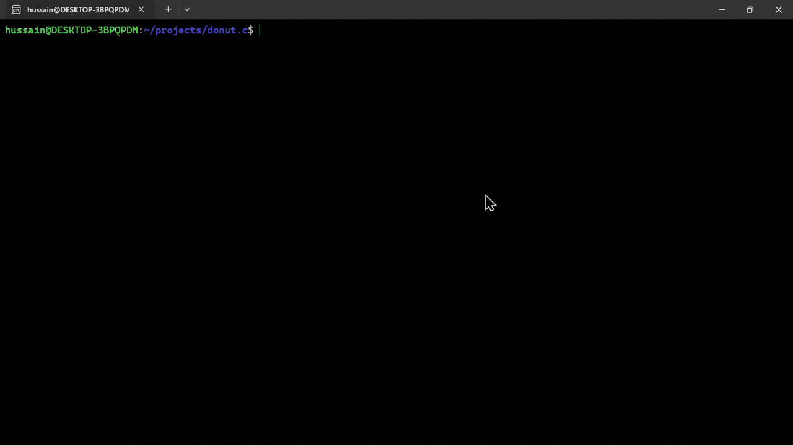

# donut.c

The idea and code are originally from the amazing Andy Sloane, where he was able to code this whole program in C and made the code itself look like a donut.

This is the [article](https://www.a1k0n.net/2011/07/20/donut-math.html), where he explained how code works.